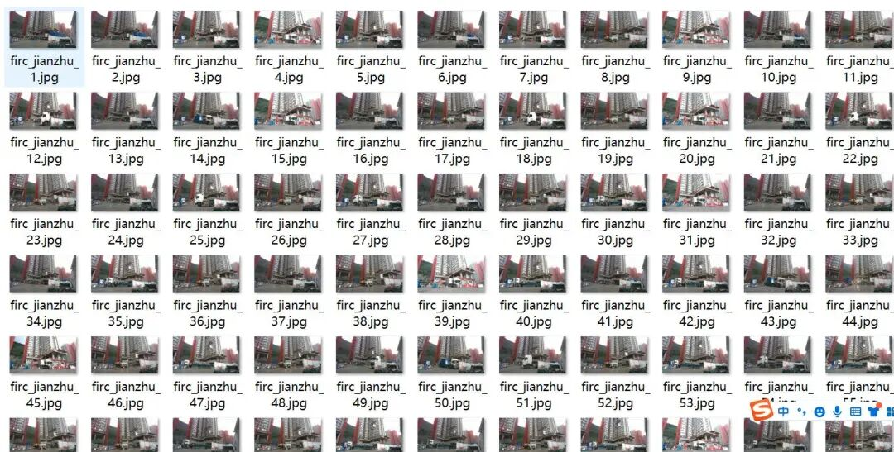
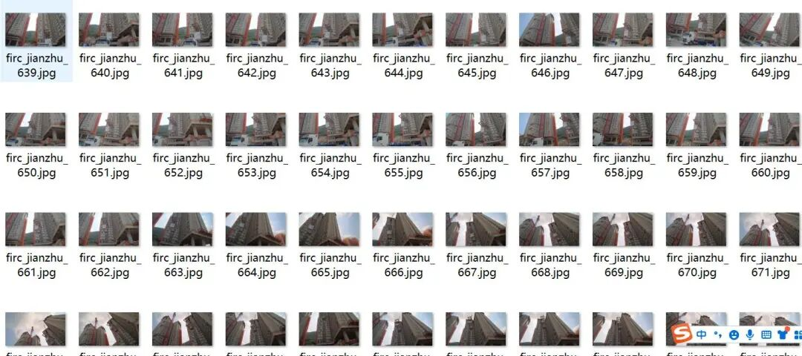
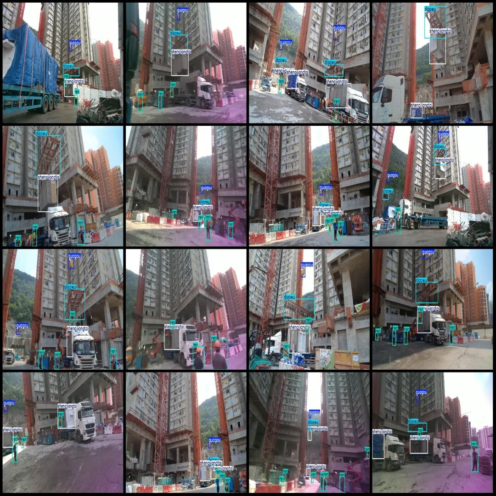

# Intelligent Construction Site Dataset: City Construction Tower Crane Hook and Object Detection in the Workplace with VOC+YOLO format, 1006 images across 4 categories

Dataset format: Pascal VOC format + YOLO format (txt file without split path, only containing jpg images and corresponding VOC format xml files and yolo format txt files)

Number of images (number of jpg files): 1006

Number of annotations (number of xml files): 1006

Number of annotations (number of txt files): 1006

Labeling category count: 4

Label category names (note that the order of categories in the YOLO format does not correspond to this, but is based on the labels folder's classes.txt): ["Diaowu", "Guagou", "Ren", "Shengjiangtai"]

Number of boxes labeled in each category:

Diaowu (suspended object) frame count = 987

Guagou (hook) frame count = 852

Number of frames = 2334

Shengjiangtai (elevator) frame count = 1371

Total frame count: 5544

Image resolution: 1280x720

Using labelImg:

Annotation rules: Draw a rectangle around the category.

Important Notice: No

Special : This dataset does not guarantee the accuracy of the trained models or weight files.

Image Preview:

Annotation example:

## Payment

Here is a pay link on Stripe ( https://buy.stripe.com/3cs8yP7sY87d0vu9AB ). Please contact me lonlonago@foxmail.com after funding $89, and I will send you a complete data files , thank you!

